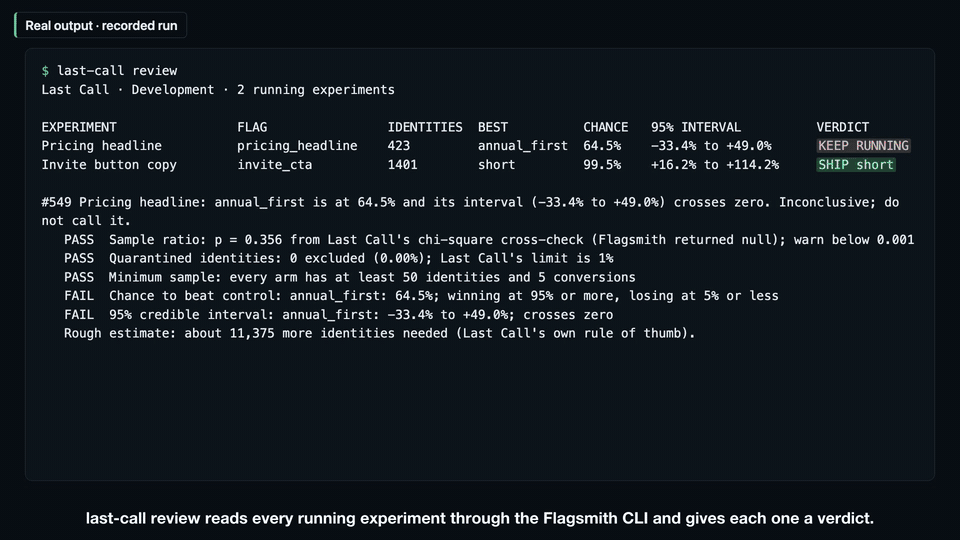
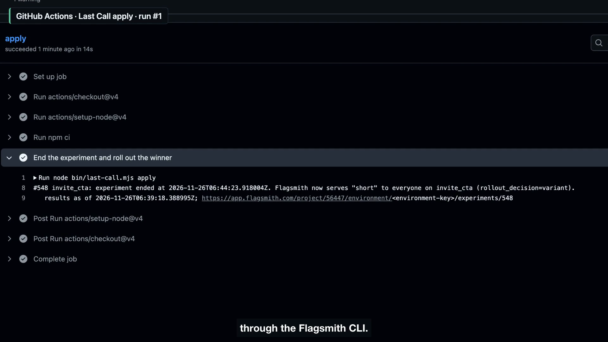
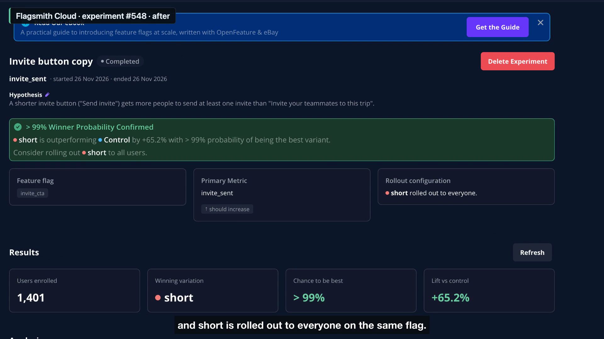

# Last Call

**Your experiment hit 99.5%. Who ends it, rolls out the winner and deletes the losing code?**

Flagsmith's docs leave the last step of an experiment to you: click End Experiment, update the flag so everyone gets the winner, then "clean up the flag and remove the losing variations". Last Call is an agent for that step. It reads a running experiment through the **Flagsmith CLI**, gives one of three verdicts, and for a winner it prepares a pull request that deletes the losing code. **Merging the pull request is the approval.** After the merge it ends the experiment and Flagsmith serves the winner to everyone on the same flag.

Built for Toggle Wars, Track 02 (AI Agents and Feature Flags).



**Verified on this repository (2026-11-26):** a human merged [pull request #1](https://github.com/coo001/last-call/pull/1) at 06:44:06 UTC. [Actions run #1](https://github.com/coo001/last-call/actions/runs/45770249684) ended experiment #548 at 06:44:23 UTC, **18 seconds after the merge**, with one `complete` call through the Flagsmith CLI, and Flagsmith rolled out `short` on the same flag. The job took 14 seconds. Timeline and evidence: [VERIFICATION.md](VERIFICATION.md#the-run-on-github-experiment-548).

**Demo video (2:20, captions burned in):** [docs/video/demo_v2.mp4](docs/video/demo_v2.mp4)

```
$ npx last-call review

Last Call · Development · 2 running experiments

EXPERIMENT                FLAG                IDENTITIES  BEST          CHANCE   95% INTERVAL          VERDICT
Pricing headline          pricing_headline    423         annual_first  64.5%    -33.4% to +49.0%      KEEP RUNNING
Invite button copy        invite_cta          1401        short         99.5%    +16.2% to +114.2%     SHIP short
```

These are live numbers from Flagsmith Cloud (free plan), read on 2026-11-26, just before pull request #1. Invite button copy has since been finished by that pull request; Pricing headline is still running. The traffic behind them is **simulated**; see [What is real and what is simulated](#what-is-real-and-what-is-simulated).

## Five minutes for judges

No Flagsmith account needed for the first three steps.

```bash
git clone https://github.com/coo001/last-call && cd last-call && npm install
npm test                      # 15 tests: the decision rule and the code cleanup
npm run demo                  # http://localhost:4173 demo app, http://localhost:4173/verdict latest verdicts
```

- [Pull request #1](https://github.com/coo001/last-call/pull/1) and [Actions run #1](https://github.com/coo001/last-call/actions/runs/45770249684) are the flow on GitHub: verdict as PR body, merge, `last-call apply` log. Open the run, then the step "End the experiment and roll out the winner".
- `verification/run-548-*.txt` are the unedited outputs of that run (review, propose, the Action's apply log, the local re-run) and the GitHub timestamps.
- `verification/rehearsal-transcript.txt` is the earlier local rehearsal on real Flagsmith Cloud with a different experiment (#550) and a local merge.
- `VERIFICATION.md` lists every Flagsmith endpoint that was called and what came back, and the timeline of the run on GitHub.
- `.lastcall/verdicts/` holds the two verdicts above as Markdown and JSON.

With your own Flagsmith project (free plan is enough):

```bash
cp .env.example .env          # admin API key, environment key, project id
npm run setup                 # creates 2 flags, 2 metrics, 2 experiments and starts them
node scripts/simulate-traffic.mjs --flag invite_cta --event invite_sent --users 1400 --rates control=0.10,short=0.16 --prefix sim-invite
node scripts/simulate-traffic.mjs --flag pricing_headline --event plan_selected --users 500 --rates control=0.20,annual_first=0.225 --prefix sim-price
npx last-call review          # about a minute after the traffic
npx last-call propose --experiment <id>     # branch + commit + PR body; add --open-pr to open it with gh
# merge the pull request, then (the GitHub Action does this for you):
npx last-call apply
```

## What is real and what is simulated

| | Real | Simulated |
|---|---|---|
| Flagsmith project, flags, experiments, results, the `complete` call | Yes, Flagsmith Cloud free plan | |
| Exposure and conversion events | Real events through the Node SDK into the managed warehouse | The users are generated by `scripts/simulate-traffic.mjs` with fixed conversion rates (10% vs 16%, and 20% vs 22.5%) |
| Statistics | Flagsmith's own engine | |
| Human approval | Pull request #1, merged by a human on GitHub. (The earlier rehearsal, experiment #550, used a local `git merge`; it is kept as a separate transcript) | Nothing |
| GitHub Action | Run #1 ended experiment #548 through the Flagsmith CLI, 18 seconds after the merge; a local re-run of `apply` afterwards did nothing. It has run once | Nothing |
| The demo app "Trailmix" | Renders by real flag values | It is not a product |

Every verdict produced from this traffic carries the line "Traffic in this experiment is simulated".

## What it does

| Step | Command | What happens | Changes Flagsmith? |
|---|---|---|---|
| 1. Read | `last-call review` | Lists running experiments, refreshes results (Flagsmith allows one refresh per 5 minutes; a 429 falls back to the last computed results), prints the verdict and the checks behind it | No |
| 2. Propose | `last-call propose --experiment <id>` | Only for SHIP. Deletes the losing branch in code, writes `.lastcall/decisions/<flag>.json`, commits both on `last-call/<flag>`, writes the PR body (the verdict). For KEEP RUNNING or STOP it prints the reason and opens nothing | No |
| 3. Approve | a human merges the PR | | No |
| 4. Apply | `last-call apply` (GitHub Action on merge) | Re-reads the experiment, refuses if the flag does not match the decision file or the verdict is no longer SHIP for the same winner, then calls `complete` | **Yes, one call** |

The cleanup, as produced for the rehearsal flag:

```diff
-import { pick } from '../lib/pick.mjs';
 export async function rehearsalBanner(flags, userId) {
-  const flag = await flags.getExperimentFlag('rehearsal_cta', userId);
-  const text = pick(flag, {
-    control: 'Try the planner',
-    bold: 'Plan your trip now',
-  });
+  const text = 'Plan your trip now';
   return `<a class="banner">${text}</a>`;
 }
```

After the merge, in Flagsmith and in the Action log:

| GitHub Action log | Flagsmith, experiment completed |
|---|---|
|  |  |

## How it uses Flagsmith

Flagsmith is the source of every number and the target of the only write. All Admin API calls go through `flagsmith api` (CLI v2), so the CLI's credential handling is the only place the admin key is used.

| Flagsmith piece | Used for |
|---|---|
| CLI v2 `flagsmith api` | Transport for every call below (`src/flagsmith.mjs`) |
| `GET /environments/<env>/experiments/` | Find running experiments, their flag, variations and metric |
| `POST .../results/refresh/`, `GET .../results/` | Lift, 95% credible interval, chance to beat control, `srm_p_value` |
| `GET .../exposures/` | Quarantined (excluded) identities |
| Flag states and the experiment's rollout segment | The configured split, for the sample-ratio cross-check |
| `POST .../experiments/<id>/complete/` | Ends the experiment and rolls the winner out on the same flag, in one request |
| Node SDK `getExperimentFlag`, `trackEvent` | The demo app and the traffic simulator send real exposure and conversion events |
| Managed warehouse (Flagsmith Cloud) | Stores those events; nothing to host |

## The decision rule

One reading only: Flagsmith's Bayesian engine. Last Call does not compute lift, the credible interval or the chance to win. It reads them from the results API and applies fixed gates in this order (`src/verdict.mjs`, no LLM involved):

| Order | Gate | Fails when | Verdict |
|---|---|---|---|
| 1 | Sample ratio | `srm_p_value` < 0.001. If Flagsmith returns `null`, Last Call runs a chi-square check on the configured split (from 100 identities) and says so | STOP |
| 2 | Quarantined identities | more than 1% of identities saw two variations (Last Call's own threshold) | STOP |
| 3 | Minimum sample | any arm under 50 identities or 5 conversions (Flagsmith's "collecting data" floor) | KEEP RUNNING |
| 4 | Win | chance to beat control ≥ 95% **and** the 95% credible interval is clear of zero | SHIP the variation |
| 5 | Loss | every variation ≤ 5% and its interval entirely on the losing side | SHIP control |
| 6 | Otherwise | | KEEP RUNNING |

Gate 4 needs both conditions, so 96% with an interval that still touches zero is not a win. For KEEP RUNNING, Last Call adds a rough count of how many more identities it would take for the interval to clear zero if the lift stayed the same. That number is Last Call's own square-root rule of thumb, it is labelled as such everywhere it appears, and it is not a power calculation.

The three boundary cases named in the tests: 99.5% with a clear interval ships; an interval crossing zero keeps running even at 84%; a 912 / 640 split on a 50/50 experiment stops before any win is read.

## Track 02 checklist

| What the track looks for | Where | Verified or not |
|---|---|---|
| Flagsmith CLI, API or MCP server | Every call is `flagsmith api ...` through CLI v2; see the table above and `VERIFICATION.md` | Verified: 16 CLI calls in the recorded review, one `complete` call in Actions run #1 |
| Saves real time | The manual checklist (read the result, End Experiment, change the flag, remove the losing code) is folded into one pull request to review and merge | Verified: after the merge, no manual step was needed and the experiment ended 18 seconds later. **Not measured:** minutes saved for a real team; we have no users yet |
| A human approves changes | Nothing is written to Flagsmith before the merge. `apply` reads only decision files that are on the merged commit | Verified: pull request #1 was merged by a person; the only write to Flagsmith is in the run that followed |
| Clear output | One table, one verdict word, the checks that led to it, and the same text as the PR body | Verified: `verification/run-548-review.txt`, pull request #1 |

## Why this step

- Flagsmith's own docs describe the ending as manual: "To roll out the winner, update the flag so every user gets the winning variation. Once it's permanent, clean up the flag and remove the losing variations." ([Analyse an Experiment](https://docs.flagsmith.com/experimentation/analyse-an-experiment))
- "When a rollout is complete or an experiment has ended, the flag should be removed from your code and from Flagsmith. In practice, flags accumulate." ([Stale Flag Detection](https://docs.flagsmith.com/managing-flags/stale-flags), which is on the Scale-up and Enterprise plans and still ends with removing the call sites by hand)
- The Flagsmith repository itself carries issues of this kind, for example [#6717 "Remove stale feature flag: environment_metrics"](https://github.com/Flagsmith/flagsmith/issues/6717).

This is evidence that the chore exists. It is not evidence that teams want this tool; we have no users yet.

## What it does not do

- It does not create or start experiments. Flagsmith's coding-agent prompt already does that.
- It does not decide with an LLM. With `--llm` and a `GEMINI_API_KEY`, a model writes two plain sentences under the verdict; the text is dropped if it contains a number that is not in the results. Without a key everything works from the template.
- It does not rewrite arbitrary code. The cleanup understands one pattern, `pick(flag, { control: ..., variation: ... })`. Any other line that still mentions the flag is listed in the PR under "Left for a human".
- It does not delete the flag in Flagsmith. After the rollout the flag still serves the winner, so old clients keep working; removing the flag is a later, separate decision.

## Limits

- Tested with one treatment and one occurrence metric per experiment. Guardrail metrics are not read yet.
- `srm_p_value` was `null` in every run we made, so the STOP path has only been exercised in unit tests.
- The flow on GitHub has run once (pull request #1, Actions run #1, experiment #548). A second experiment, a failed run and the refusal paths of `apply` have not been exercised on GitHub, and the refusals have no unit test yet (the 15 tests cover the decision rule and the code cleanup).
- The rollout applies to the environment the experiment ran in (Development in this project). Other environments are not touched.
- Experimentation is in beta; the endpoints above may change.

## AI disclosure

Code and text in this repository were written with AI coding assistants and reviewed by the author. The optional `--llm` sentence uses Gemini. No AI-generated data is presented as real: simulated traffic is labelled wherever it appears.

## Layout

```
bin/last-call.mjs        CLI entry
src/flagsmith.mjs        Flagsmith CLI wrapper     src/verdict.mjs   decision rule
src/cleanup.mjs          losing-code removal       src/narrate.mjs   verdict Markdown, optional LLM sentence
demo/                    Trailmix demo app and /verdict page
scripts/                 setup-experiments, simulate-traffic, probe
.github/workflows/       last-call-apply.yml (runs apply after a merge)
```

MIT licence.
